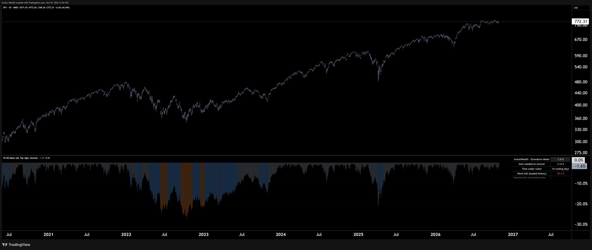

# InvestWealth Drawdown Meter (TradingView, free and open source)

A free TradingView indicator that shows something most charts leave out: **how far a market is below its own high, and what it would take to get back.**

**Add it to your chart:** [InvestWealth Drawdown Meter in the TradingView public library](https://www.tradingview.com/script/16TqCaHj-InvestWealth-Drawdown-Meter/)

This repository holds the same Pine Script v6 source, so you can read it, copy it or adapt it under the Mozilla Public License 2.0.

---

## What it shows

On any symbol and any timeframe:

| | |
|---|---|
| **Columns** | The fall from the highest point in the loaded history, in %. 0 % means a new high. Grey above −10 %, blue to −20 %, orange to −30 %, red beyond. |
| **Current drawdown** | How far the price is below its high right now. |
| **Gain needed to recover** | The rise needed to get back to that high. |
| **Time under water** | How long since the last high: bars, plus calendar years once a spell passes one year. |
| **Worst fall** | The deepest drawdown in the bars loaded on the chart. |

## Why "gain needed to recover" matters

Losses and gains are not symmetric.

| Fall | Gain needed to get back |
|---|---|
| −10 % | +11 % |
| −20 % | +25 % |
| −33 % | +50 % |
| −50 % | +100 % |
| −55 % (S&P 500, 2007–09) | +122 % |
| −80 % | +400 % |

The meter does this arithmetic on every bar. It is the quickest way to see why avoiding deep falls matters more than catching every rally.

## How to read it

- **Scroll back.** The worst-fall figure only covers the bars that are loaded. On a daily S&P 500 chart with full history you should see about −55 % (2007–09) and −34 % (2020).
- **Time under water** counts bars since the last high: trading days on a daily chart, weeks on a weekly chart.
- **"Measure from highs and lows"** (on by default) uses the highest high and today's low, the way a fall is actually experienced. Switch it off to use closes only, which is smoother.

## Alerts

- The drawdown becomes deeper than your level (default −20 %).
- The market is back at a new high.

## Settings

Alert level · highs/lows or closes · show or hide the table · table position · table text size. The table follows your chart theme (light text on dark charts, dark text on light charts).

## Install from source

1. In TradingView, open the **Pine Editor** at the bottom of a chart.
2. Paste the contents of [`InvestWealth_Drawdown_Meter.pine`](InvestWealth_Drawdown_Meter.pine).
3. Click **Save**, then **Add to chart**.

Or skip this and add the published version from the [public library](https://www.tradingview.com/script/16TqCaHj-InvestWealth-Drawdown-Meter/), which stays up to date.

## Notes

- Pine Script v6. Uses closed bars only and never repaints: once a bar has closed, its values do not change.
- A drawdown describes where a market stands. It does not say what the market will do next.

## More from InvestWealth

- **Learn:** [Maximum drawdown explained, with charts](https://www.investwealth.com/learn/guides/max-drawdown?utm_source=github&utm_campaign=gh_dd_meter)
- **Free Research Terminal:** 30 markets with trend, drawdown and risk side by side ([open a free account](https://www.investwealth.com/register?utm_source=github&utm_campaign=gh_dd_meter))
- **InvestWealth TradingView Indicator Suite:** five tools that apply the same research framework to your own charts: Trend Stages, Drawdown & Recovery, Volatility Target, Cross-Asset Scoreboard and Regime Monitor "Hedge Health". €149 a year, included in Premium ([details](https://www.investwealth.com/tradingview-indicators?utm_source=github&utm_campaign=gh_dd_meter))
- **Open data:** [US retirement data since 1872](https://github.com/investwealth-com/investwealth-retirement-1872)

## Licence

[Mozilla Public License 2.0](LICENSE). © 2026 Harry Hamann, InvestWealth.

---

*Educational research, not investment advice. Past returns do not guarantee future results. TradingView is a trademark of TradingView, Inc.; this project is not affiliated with or endorsed by TradingView.*
